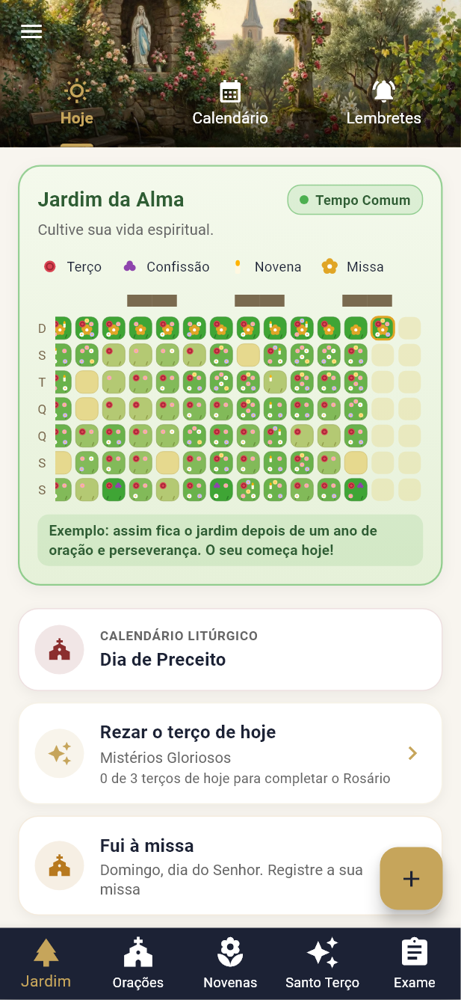
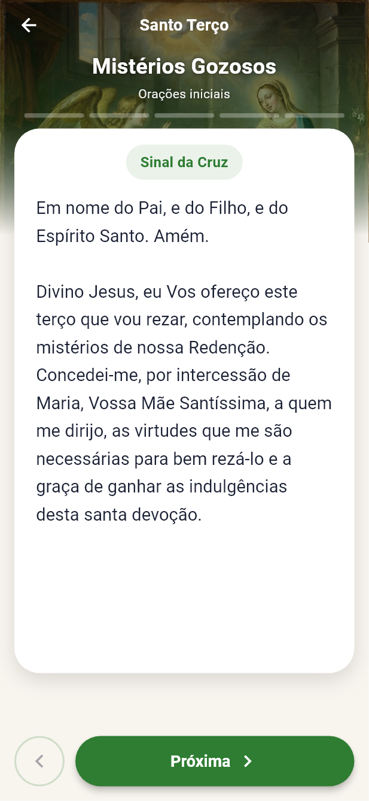
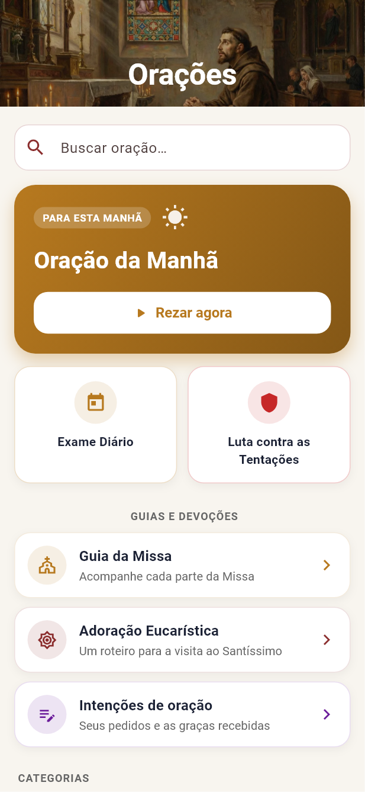
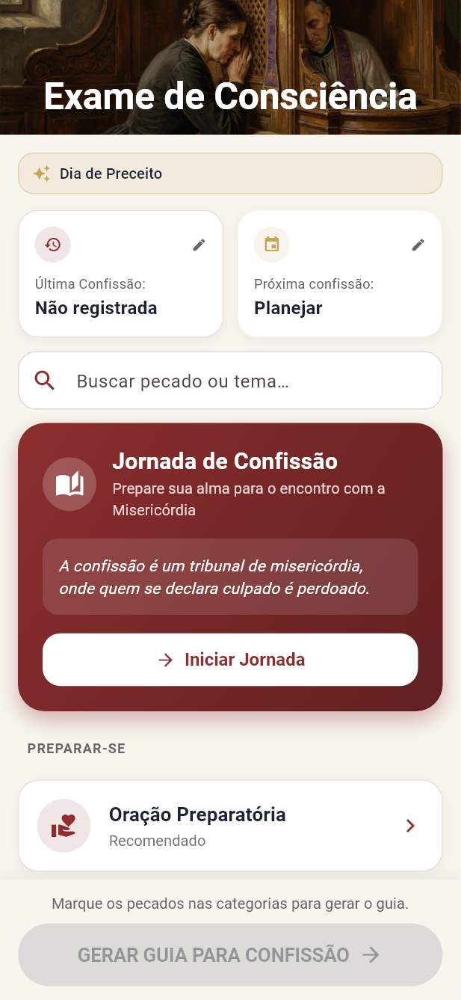

# Sancta Devocionário Católico

Aplicativo gratuito, sem anúncios e sem conta, para a vida de oração católica: **Jardim da Alma**, plano de orações do dia, **Santo Terço guiado**, novenas, orações tradicionais, exame de consciência e guias da Missa e da Adoração. Em português e inglês.

<p>
  
  
  
  
</p>

## Privacidade
- Tudo fica no celular (banco SQLite local). Não há conta, login, anúncios nem estatísticas.
- O app **não pede a permissão de internet**; só abre links (como o de doação) no navegador, quando você toca neles.
- O backup é feito por você, quando quiser. A senha do Exame não entra no backup.

## Apoie o projeto
O app foi feito por um casal que se prepara para o matrimônio, para ajudar nas despesas do casamento e para que os católicos rezem bem. Quem quiser colaborar pode usar PIX, cartão/PayPal (Ko-fi: <https://ko-fi.com/sanctadevocionario>) ou criptomoedas, em **Sobre o Projeto**, no menu. Uma oração por nós já é um grande presente.

## Compilar
Requer o [Flutter](https://docs.flutter.dev/get-started/install) (3.38 ou mais novo).

```bash
flutter pub get
flutter gen-l10n
flutter test
flutter run
```

Versão para lojas que não aceitam links de doação (esconde PIX, cartão e cripto): `flutter build apk --dart-define=DONATION_LINKS=false`.
Assinatura de release: veja `PUBLICACAO_FASE1.md` e `tool/build_release.ps1`.

## Licença
O **código** é distribuído sob a [GNU GPL v3](LICENSE). Os **textos** de orações, novenas e guias e as **imagens** têm origens diversas; a conferência de direitos está em [TEXTOS_ORIGEM.md](TEXTOS_ORIGEM.md) e a licença do código não os cobre automaticamente.
