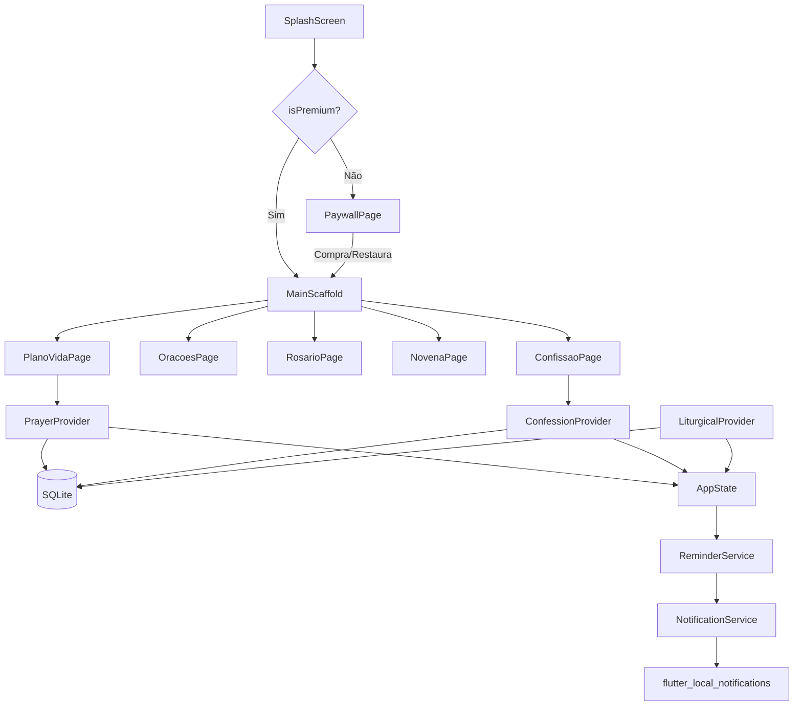

# 📖 Relatório Técnico — AppSancta

> **Versão do relatório:** Abril 2026  
> **Plataforma:** Flutter (Android/iOS)  
> **Banco de dados:** SQLite (`sancta_conscientia.db`) — Versão de schema 5

---

## 1. Visão Geral do Projeto

O **AppSancta** (package: `sanctaconscientia`) é um devocionário católico desenvolvido em Flutter que oferece:

- Gestão de orações diárias com sistema de heatmap ("Jardim da Alma")
- Acompanhamento de novenas (9 dias automáticos)
- Contagem de terços com mistérios litúrgicos
- Módulo de confissão com exame de consciência e controle de penitências
- Lembretes e notificações locais
- Calendário litúrgico com dias de preceito, jejum e abstinência
- Monetização via RevenueCat (paywall)

---

## 2. Arquitetura da Aplicação

### 2.1 Stack Tecnológica

| Camada | Tecnologia |
|--------|-----------|
| Framework | Flutter 3.x |
| Estado | `provider` (ChangeNotifier) |
| Persistência | `sqflite` — SQLite local |
| Notificações | `flutter_local_notifications` + `flutter_timezone` |
| Monetização | `purchases_flutter` (RevenueCat) |
| Internacionalização | `flutter_localizations` + ARB files |
| Modelo de dados | `freezed` + `json_serializable` |

### 2.2 Estrutura de Diretórios

```
lib/
├── main.dart                   # Entry point — MultiProvider + inicialização
├── providers/                  # Estado global (ChangeNotifier)
│   ├── app_state.dart          # Coordenador central de Reminders
│   ├── prayer_provider.dart    # Orações diárias, novenas, logs, heatmap
│   ├── confession_provider.dart # Confissões, pecados, penitências
│   ├── liturgical_provider.dart # Calendário litúrgico
│   ├── settings_provider.dart  # Configurações do usuário
│   └── subscription_provider.dart # Status de subscrição (RevenueCat)
├── services/
│   ├── database_service.dart   # Singleton — gestão do SQLite
│   ├── reminder_service.dart   # Agendamento/cancelamento de notificações
│   └── notification_service.dart # Wrapper flutter_local_notifications
├── pages/                      # Páginas principais
│   ├── main_scaffold.dart      # Navegação por bottom nav (IndexedStack)
│   ├── splash_screen.dart      # Inicialização e roteamento
│   ├── paywall_page.dart       # Tela de compra (hard paywall)
│   ├── plano_vida_page.dart    # Jardim da Alma (3 abas)
│   ├── plano_vida/             # Sub-tabs do Jardim
│   │   ├── hoje_tab.dart       # Orações do dia
│   │   ├── historico_tab.dart  # Heatmap e calendário
│   │   └── lembretes_tab.dart  # Gestão de lembretes
│   └── ...
├── models/                     # Modelos de dados (freezed)
├── data/                       # Dados estáticos (orações, novenas)
├── theme/                      # Cores, tipografia
└── l10n/                       # Arquivos de localização (ARB)
```

### 2.3 Fluxo de Inicialização

```
main() → MultiProvider → SplashScreen
    └─ _initializeApp()
        1. AppState.loadSavedData()      ← lembretes e reminders
        2. Parallel: Settings + Confession + Prayer loads
        3. LiturgicalProvider.loadSettings()
        4. SubscriptionProvider.init()   ← RevenueCat (timeout: 5s)
        └─ isPremium? → MainScaffold : PaywallPage
```

> [!IMPORTANT]
> O `AppState` deve ser inicializado **primeiro** pois ele carrega os `Reminders` do banco, que são necessários para os outros providers. A ordem de inicialização no `SplashScreen` é sequencial e proposital.

---

## 3. Camada de Persistência — SQLite

### 3.1 Banco de Dados

**Arquivo:** `sancta_conscientia.db`  
**Versão do schema:** 5  
**Serviço:** `DatabaseService` (singleton)

### 3.2 Tabelas

| Tabela | Propósito |
|--------|-----------|
| `sins` | Registro de pecados com categoria, grau e frequência |
| `confession_history` | Histórico de confissões com data e notas |
| `active_novenas` | Novenas em andamento com data início/fim e lembrete |
| `daily_prayers_status` | Status das orações do dia (para heatmap) |
| `prayer_logs` | Registros brutos de orações realizadas |
| `scheduled_prayers` | Orações agendadas pelo usuário com período do dia |
| `reminders` | Lembretes unificados com tipo, recorrência e referência |
| `penances` | Penitências vinculadas às confissões |

### 3.3 Schema — Tabela `reminders` (Central)

```sql
CREATE TABLE reminders (
    id INTEGER PRIMARY KEY AUTOINCREMENT,
    type TEXT NOT NULL,           -- ReminderType (prayer, novena, confession...)
    referenceId TEXT,             -- ID da oração/novena associada
    title TEXT NOT NULL,
    body TEXT,
    time TEXT NOT NULL,           -- HH:MM
    recurrenceType TEXT,          -- once, daily, weekly, monthly
    weekday INTEGER,              -- 1-7 (para recorrência semanal)
    monthDay INTEGER,             -- 1-31 (para recorrência mensal)
    date TEXT,                    -- ISO 8601 (para agendamentos únicos)
    isActive INTEGER DEFAULT 1,
    notificationId INTEGER        -- ID usado no sistema de notificações
)
```

### 3.4 Migração de Dados

O `DatabaseService` implementa `migrateFromSharedPreferences()` para migrar dados legados (SharedPreferences) para o SQLite. A migração é idempotente e só é executada uma vez.

---

## 4. Sistema de Provedores (Estado)

### 4.1 `AppState` — Coordenador Central

- Carrega todos os `Reminders` do banco via `ReminderService`
- Expõe `reminders` para a UI (lista de lembretes)
- Oferece métodos para adicionar/remover lembretes que chamam `ReminderService`
- É o único provider que opera diretamente com o `ReminderService`

### 4.2 `PrayerProvider` — Orações e Novenas

**Responsabilidades:**
- Carregar orações agendadas (`scheduled_prayers`)
- Gerenciar status diários (`daily_prayers_status`)
- Registrar logs de oração (`prayer_logs`)
- Iniciar/encerrar novenas (`active_novenas`)
- Calcular dados para o heatmap
- Delegar lembretes ao `AppState` → `ReminderService`

**Métodos principais:**

| Método | Descrição |
|--------|-----------|
| `loadData()` | Carrega orações agendadas e status do dia |
| `addPrayer(title, ...)` | Insere nova oração no plano diário |
| `completePrayer(id)` | Marca oração como concluída e loga no `prayer_logs` |
| `logPrayer(title, date, ...)` | Registra oração em data específica (passado/presente) |
| `startNovena(id, startDate, ...)` | Inicia rastreamento de novena de 9 dias |
| `setPrayerReminder(id, time, ...)` | Agenda lembrete via AppState |
| `getHeatmapData()` | Retorna mapa `{DateTime: HeatmapEntry}` para 365 dias |

**Lógica do Heatmap:**

```
getHeatmapData():
    1. Buscar daily_prayers_status (últimos 365 dias)
    2. Buscar prayer_logs (últimos 365 dias)  
    3. Agregar por data evitando dupla contagem
    4. Para cada oração concluída: +1 (verde mais escuro)
    5. Rosário: bolinha vermelha
    6. Confissão: bolinha roxa
    7. Novena: bolinha amarela
    8. Retornar Map<DateTime, HeatmapEntry>
```

### 4.3 `ConfessionProvider` — Confissão e Penitências

- Carrega histórico de confissões do banco
- Gerencia registro de pecados (categoria, grau, frequência)
- Controla o estado da "jornada de confissão" (multi-step)
- Rastreia penitências ativas e concluídas
- Agenda lembretes de confissão periódicos via `AppState`

### 4.4 `LiturgicalProvider` — Calendário Litúrgico

- Calcula dias de preceito (domingos e festas), jejum e abstinência
- Determina o "tempo litúrgico" (Advento, Natal, Quaresma...)
- Agenda automaticamente notificações para dias especiais
- Expõe o estado litúrgico do dia para a UI

### 4.5 `SubscriptionProvider` — Monetização

- Inicializa o SDK do RevenueCat (`purchases_flutter`)
- Verificar entitlement `"premium"` para liberar o conteúdo
- Suporta compra de pacote e restauração de compras
- **Atenção:** o `restorePurchases()` tem mock de desenvolvimento ativado (linha 103) que sempre retorna `isPremium = true` em caso de erro. **Remover antes de produção.**

---

## 5. Sistema de Notificações

### 5.1 Arquitetura de Notificações

```
PrayerProvider / ConfessionProvider / LiturgicalProvider
    → AppState.addReminder()
        → ReminderService.scheduleNotifications()
            → NotificationService.schedule[Daily/Weekly/Specific]Notification()
                → FlutterLocalNotificationsPlugin.zonedSchedule()
```

### 5.2 `NotificationService` — Wrapper

Métodos disponíveis:

| Método | Tipo de Agendamento |
|--------|-------------------|
| `scheduleNotification()` | Único (OneShot) |
| `scheduleDailyNotification()` | Diário (mesmo horário) |
| `scheduleWeeklyNotification()` | Semanal (dia + horário) |
| `scheduleRepeatingNotification()` | Genérico com `DateTimeComponents` |
| `scheduleSpecificDateNotification()` | Data específica + horário |

**Tratamento de permissões:** implementa fallback de `exactAllowWhileIdle` → `inexactAllowWhileIdle` para `SecurityException` no Android.

**Payload de notificações:** As notificações usam JSON como payload para identificar qual aba/tela abrir ao clicar.

### 5.3 `ReminderService` — Agendamento de Negócio

Tipos de lembrete (`ReminderType`):
- `prayer` — Oração específica
- `novena` — Novena diária
- `confession` — Lembrete periódico para confessar
- `liturgical` — Dia litúrgico especial

Tipos de recorrência (`RecurrenceType`):
- `once` — Uma vez
- `daily` — Todo dia
- `weekly` — Semanalmente (por dia da semana)
- `monthly` — Mensalmente (por dia do mês)

**ID de notificações:** gerado por hashing do `referenceId` + `type` para garantir unicidade e permitir cancelamento preciso.

---

## 6. Navegação e Roteamento

### 6.1 Estrutura de Navegação

```
SplashScreen
    └─ PaywallPage (se não premium)
        └─ MainScaffold (se autorizado ou após compra)
            ├─ Tab 0: PlanoVidaPage (Jardim da Alma)
            │   ├─ HojeTab
            │   ├─ HistoricoTab (heatmap)
            │   └─ LembretesTab
            ├─ Tab 1: OracoesPage
            ├─ Tab 2: RosarioPage (Terço)
            ├─ Tab 3: NovenaPage
            └─ Tab 4: ConfissaoPage (protegida por senha)
```

### 6.2 `MainScaffold` — Gerenciamento de Abas

- Usa `IndexedStack` para manter estado de todas as abas ao navegar
- Intercepta payloads de notificações para navegar para a aba/tela correta
- Suporta abertura direta de páginas de detalhe via `Navigator.push`

### 6.3 Roteamento por Notificação

Quando o usuário clica em uma notificação (app aberto ou ao abrir):
1. `NotificationService` captura o payload
2. `MainScaffold` recebe via callback `onNotificationClick`
3. Faz parse do JSON do payload
4. Navega para a aba e tela correspondente

---

## 7. Jardim da Alma — Fluxo Detalhado

A `PlanoVidaPage` é composta por 3 abas:

### Aba 1: Hoje (`HojeTab`)
- Lista de orações do dia (de `scheduled_prayers`)
- Cada item pode ser marcado como concluído → `PrayerProvider.completePrayer()`
- Botão FAB para adicionar nova oração ao plano via `showPrayerSelectionDialog()`

### Aba 2: Histórico (`HistoricoTab`)
- Exibe o **heatmap** de 365 dias (cor varia conforme quantidade/tipo de orações)
- Contadores diário e semanal
- Histórico de confissões

### Aba 3: Lembretes (`LembretesTab`)
- Lista lembretes ativos do `AppState`
- Permite pausar, reativar e excluir lembretes

### Diálogo de Adição de Oração

`showPrayerSelectionDialog()` exibe 4 abas:
1. **Orações** — Catálogo por categoria (main, daily, saints, jaculatórias, litânias, especiais)
2. **Novenas** — Catálogo de novenas
3. **Terços** — Seleção de mistério (automático ou específico)
4. **Oração Rápida** — Log imediato sem agendar

Após selecionar, exibe `_showSchedulingDialog()` para configurar:
- Período do dia (manhã, tarde, noite, qualquer)
- Lembrete opcional com hora e recorrência

---

## 8. Pontos Críticos e Alertas

> [!WARNING]
> **Mock de RevenueCat ativo em produção:** O `SubscriptionProvider.restorePurchases()` retorna `isPremium = true` em caso de erro (linha 103). Isso significa que qualquer usuário que tentar "Restaurar Compras" com um erro de rede ou conta sem compra terá acesso liberado. **Deve ser corrigido antes do lançamento.**

> [!WARNING]
> **Chaves de API placeholder:** `_googleApiKey = "goog_placeholder_key"` e `_iosApiKey = "appl_placeholder_key"` estão no código. Precisam ser substituídas pelas chaves reais do RevenueCat antes de produção.

> [!CAUTION]
> **Notificações após reinicialização:** Notificações agendadas com `flutter_local_notifications` são perdidas quando o app é desinstalado ou em alguns dispositivos após reinicialização. O `ReminderService` precisa ser invocado ao reinicializar o app (via `AppState.loadSavedData()`) para re-agendar. Verificar se o `boot receiver` no Android está configurado.

> [!NOTE]
> **Migração SharedPreferences → SQLite:** A migração só é executada uma vez. Se um usuário tiver dados legados e nunca abrir o app após a migração ser lançada, os dados podem ser perdidos. Considerar adicionar uma verificação robusta de dados legados.

---

## 9. Checklist de Pendências para Produção

- [ ] 🔑 Substituir chaves de API do RevenueCat (Android + iOS)
- [ ] 🐛 Remover mock de `restorePurchases()` (linha 103 do `subscription_provider.dart`)
- [ ] 🔔 Implementar `boot receiver` Android para re-agendar notificações após reinicialização
- [ ] 🧪 Testar fluxo completo de compra com conta de teste do RevenueCat
- [ ] 🏷️ Configurar entitlement `"premium"` no dashboard do RevenueCat
- [ ] 📱 Validar payloads de notificação em todos os tipos de lembrete
- [ ] 🌐 Revisar strings de localização (verificar se todas as strings estão nos arquivos ARB)
- [ ] 🔐 Revisar robustez da proteção por senha do módulo de Confissão

---

## 10. Diagrama de Fluxo de Dados


